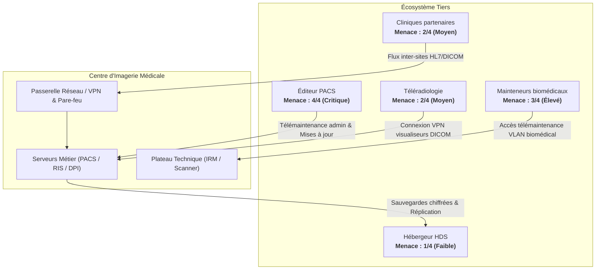

# Atelier 3 : Scénarios Stratégiques (Écosystème)

L'Atelier 3 de la méthode **EBIOS RM** a pour objectif de cartographier l'écosystème du centre d'imagerie médicale et d'évaluer le niveau de menace posé par chaque partie prenante. Cette analyse permet de modéliser les chemins d'attaque par lesquels des sources de risque peuvent exploiter les tiers (fournisseurs, partenaires, sous-traitants) ou attaquer directement le système d'information pour atteindre leurs objectifs.

---

## 1. Méthode d'Évaluation de la Menace sur l'Écosystème

Conformément à la méthodologie EBIOS RM, chaque partie prenante est qualifiée selon 4 composantes évaluées sur une échelle de **1 à 4** :

- **Dépendance ($D$)** [1–4] : Degré de dépendance opérationnelle ou métier du centre envers le tiers (1: Mineure, 2: Significative, 3: Forte, 4: Critique).
- **Pénétration ($P$)** [1–4] : Degré d'interconnexion ou de privilège d'accès du tiers sur le SI (1: Isolé, 2: Limité, 3: Fort/Direct, 4: Accès administrateur/Permanent).
- **Maturité ($M$)** [1–4] : Niveau de maturité cybersécurité démontré par le tiers (1: Faible, 2: Moyenne, 3: Forte, 4: Exemplaire/Certifié).
- **Confiance ($C$)** [1–4] : Degré de confiance accordé au tiers sur la base des garanties contractuelles, labels et audits (1: Faible, 2: Moyenne, 3: Forte, 4: Maximale/Auditée).

### Formule de calcul du Niveau de Menace (`threat_level`)

Le niveau de menace intrinsèque d'une partie prenante résulte du rapport entre son potentiel d'exposition ($D \times P$) et ses mécanismes de maîtrise ($M \times C$) :

$$\text{threat\_level} = \min\left(4, \max\left(1, \operatorname{round}\left(\frac{\text{dependency} \times \text{penetration}}{\text{maturity} \times \text{trust}}\right)\right)\right)$$

L'échelle finale s'établit de **1** (Menace faible) à **4** (Menace critique).

---

## 2. Cartographie des Parties Prenantes de l'Écosystème

Le tableau suivant récapitule l'évaluation des 5 parties prenantes critiques du centre d'imagerie médicale :

| ID | Partie Prenante | Type | D (1-4) | P (1-4) | M (1-4) | C (1-4) | Menace calculée (1-4) | Description & Périmètre d'accès |
|---|---|---|:---:|:---:|:---:|:---:|:---:|---|
| **pp_editeur_pacs** | Éditeur du PACS | Fournisseur logiciel | **4** | **4** | **2** | **2** | **4** *(Critique)* | Cœur applicatif du SI d'imagerie ; accès administrateur à privilèges pour la télémaintenance et diffusion des patchs logiciels. $(16 / 4 = 4.0)$ |
| **pp_mainteneurs_bio** | Mainteneurs biomédicaux | Fournisseur service / matériel | **4** | **3** | **2** | **2** | **3** *(Élevé)* | Maintien en condition opérationnelle des scanners et IRM ; accès direct au VLAN biomédical et consoles modalités. $(12 / 4 = 3.0)$ |
| **pp_teleradiologie** | Service de téléradiologie | Prestataire de télé-soins | **3** | **3** | **2** | **2** | **2** *(Moyen)* | Interprétation des urgences radiologiques la nuit via tunnel VPN dédié vers les visualiseurs DICOM. $(9 / 4 = 2.25 \rightarrow 2)$ |
| **pp_cliniques_partenaires** | Cliniques partenaires | Partenaire de santé | **2** | **3** | **2** | **2** | **2** *(Moyen)* | Établissements de soins interconnectés en VPN inter-sites pour l'échange de dossiers et de comptes rendus. $(6 / 4 = 1.5 \rightarrow 2)$ |
| **pp_hebergeur_hds** | Hébergeur certifié HDS | Hébergeur Cloud HDS | **4** | **2** | **4** | **4** | **1** *(Faible)* | Hébergement souverain certifié HDS / ISO 27001 pour les sauvegardes externalisées et la réplication PACS. $(8 / 16 = 0.5 \rightarrow 1)$ |

*(Données source : `grc/ebios/w3_strategiques.yaml`)*

---

## 3. Schéma de l'Écosystème et des Flux Tiers

---

## 4. Scénarios Stratégiques Évalués

Les scénarios stratégiques croisent les sources de risque et objectifs retenus (Atelier 2) avec les vulnérabilités de l'écosystème ou les vecteurs directs du SI. Chaque scénario décrit un chemin d'attaque en 2 à 3 étapes et associe les mesures de sécurité spécifiques à déployer :

| ID | Nom du Scénario | Vecteur / Partie Prenante | Couple SR/OV | Vraisemblance (1-4) | Chemin d'attaque (2-3 étapes) | Mesures sur l'Écosystème |
|---|---|---|---|:---:|---|---|
| **sc_strat_1** | Supply chain via l'éditeur PACS | Éditeur du PACS (`pp_editeur_pacs`) | `srov_1` *(Cybercriminels $\times$ Extorsion)* | **3** *(Forte)* | 1. Compromission CI/CD de l'éditeur. 2. Injection et diffusion d'un patch malveillant. 3. Chiffrement local du PACS. | Audits de code tiers imposés par contrat, contrôle des hashs SHA-256 et recette sur pré-production isolée. |
| **sc_strat_2** | Rebond via le VPN de téléradiologie | Service de téléradiologie (`pp_teleradiologie`) | `srov_2` *(Cybercriminels $\times$ Vol données)* | **3** *(Forte)* | 1. Infection d'un poste distant de radiologue. 2. Rebond via le VPN permanent. 3. Exfiltration silencieuse de données RIS/PACS. | MFA obligatoire sur tout accès VPN, contrôle de posture du poste distant (EDR) et segmentation réseau stricte. |
| **sc_strat_3** | Usurpation d'accès d'un mainteneur biomédical | Mainteneurs biomédicaux (`pp_mainteneurs_bio`) | `srov_1` *(Cybercriminels $\times$ Extorsion)* | **3** *(Forte)* | 1. Vol d'identifiants de télémaintenance. 2. Connexion distante sur console IRM. 3. Blocage de l'équipement pour extorsion. | Télémaintenance à la demande validée par le centre, comptes nominatifs stricts (pas de générique), VLAN biomédical isolé. |
| **sc_strat_4** | Propagation et altération via une clinique partenaire | Cliniques partenaires (`pp_cliniques_partenaires`) | `srov_6` *(Cybercriminels $\times$ Altération)* | **2** *(Significative)* | 1. Infection du réseau d'une clinique partenaire. 2. Traversée de la liaison inter-sites. 3. Falsification de comptes rendus médicaux. | Filtrage applicatif HL7/DICOM sur pare-feu, signature électronique des comptes rendus, convention bilatérale de sécurité. |
| **sc_strat_5** | Destruction des sauvegardes chez l'hébergeur HDS | Hébergeur HDS (`pp_hebergeur_hds`) | `srov_1` *(Cybercriminels $\times$ Extorsion)* | **2** *(Significative)* | 1. Vol de credentials cloud HDS. 2. Effacement des snapshots et archives PACS. 3. Déploiement d'un rançongiciel local sans retour arrière possible. | Sauvegardes immuables (WORM/Object Lock), MFA matériel FIDO2 sur la console cloud, journaux d'audit externes infalsifiables. |
| **sc_strat_6** | Attaque directe du SI (phishing, RDP exposé) | *Attaque directe* (`null`) | `srov_1` *(Cybercriminels $\times$ Extorsion)* | **4** *(Maximale)* | 1. Phishing ciblé ou brute force RDP. 2. Prise de contrôle et élévation de privilèges AD. 3. Déploiement généralisé d'un rançongiciel. | Sensibilisation anti-phishing, fermeture stricte du RDP direct (bastion VPN/MFA), solution EDR avec surveillance SOC. |
| **sc_strat_7** | Abus d'accès interne et vol de données | *Acteur interne* (`null`) | `srov_3` *(Interne $\times$ Vol données)* | **2** *(Significative)* | 1. Exploitation d'un compte interne légitime. 2. Extraction massive de dossiers patients. 3. Exfiltration via support USB ou messagerie. | DLP et blocage physique des ports USB, traçabilité des consultations médicales, politique de moindre privilège. |
| **sc_strat_8** | Saturation de la connexion Internet (DDoS) | *Attaque directe* (`null`) | `srov_4` *(Hacktivistes $\times$ Indisponibilité)* | **3** *(Forte)* | 1. Attaque DDoS par amplification volumétrique. 2. Saturation de la liaison fibre principale. 3. Rupture de la téléradiologie et de l'accueil. | Option anti-DDoS opérateur (scrubbing), liaison secours indépendante (4G/5G/opérateur tiers), mode secours déconnecté. |
| **sc_strat_9** | Défaillance majeure du stockage NAS/SAN | *Défaillance technique* (`null`) | `srov_5` *(Défaillance $\times$ Indisponibilité)* | **2** *(Significative)* | 1. Défaillance physique de disques RAID en cascade. 2. Rupture de la baie de stockage centrale. 3. Arrêt de production et bascule vers le PCA. | Baie haute disponibilité (double contrôleur, double alim), contrat GTR 4h avec pièces sur site, supervision matérielle continue. |

*(Données source : `grc/ebios/w3_strategiques.yaml`)*
