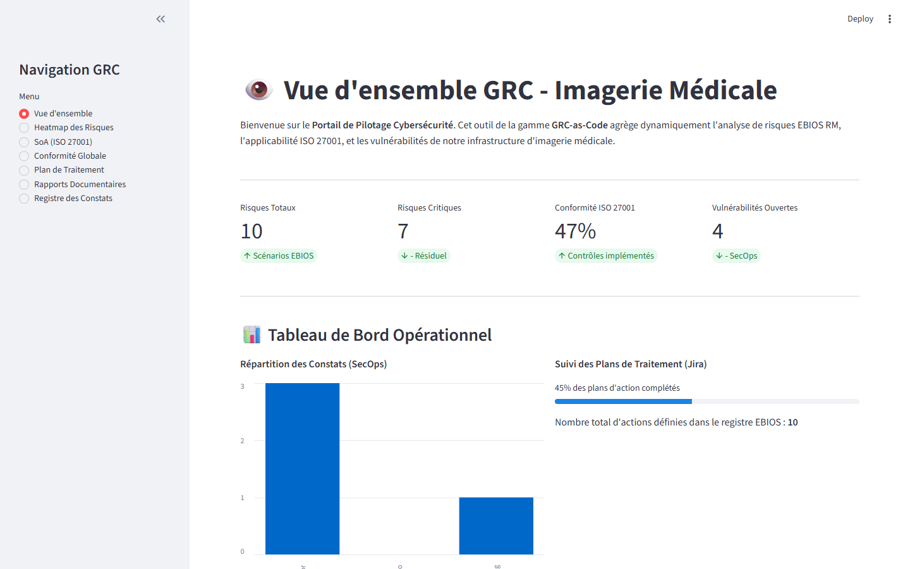
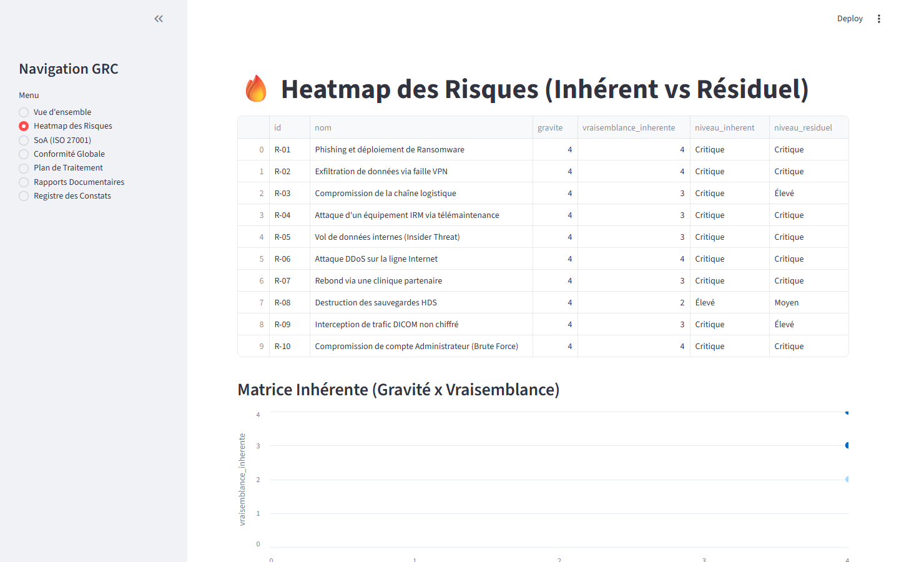
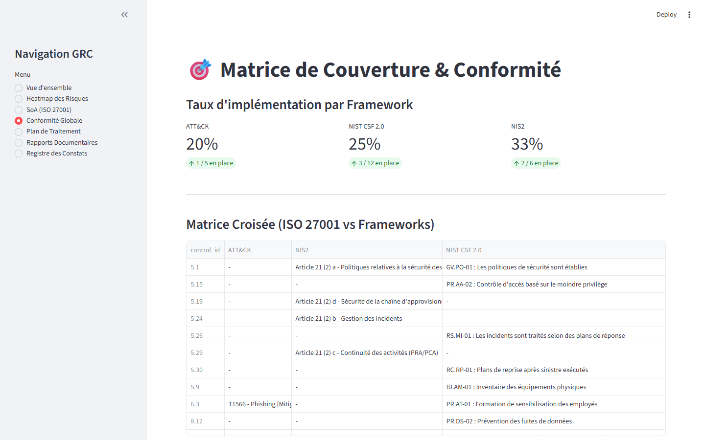

# Aperçu du Tableau de Bord Interactif (Streamlit)

> [!NOTE]
> **Hébergement statique :** GitHub Pages diffuse une documentation statique générée par MkDocs. Le serveur dynamique Streamlit (connecté à l'API FastAPI et à la base de données PostgreSQL) ne peut pas être exécuté directement dans cet environnement. Cette page propose une visite visuelle des interfaces de pilotage à travers les captures d'écran de l'application opérationnelle.

Pour exécuter le tableau de bord en local sur votre poste :
```bash
# Via Docker Compose (recommandé)
docker compose up -d
# Le dashboard est alors accessible sur http://localhost:8501
```

---

## 1. Vue d'Ensemble & Indicateurs Clés (Overview)

La page d'accueil du tableau de bord synthétise les métriques de sécurité et l'état de santé cyber global du centre d'imagerie médicale :
* **Scores inhérents vs résiduels** calculés selon la méthode EBIOS RM / ISO 27001 ;
* **Suivi de la maturité moyenne** des contrôles de sécurité déployés ;
* **Répartition des risques par niveau de criticité** (Critique, Élevé, Moyen, Faible).



---

## 2. Matrice de Criticité & Heatmap des Risques

La matrice de risque dynamique $4 \times 4$ positionne les 12 scénarios opérationnels (R-01 à R-12) en fonction de leur gravité et de leur vraisemblance :
* Visualisation immédiate de l'impact des mesures de traitement (glissement des risques du niveau Critique vers les zones Moyen et Faible) ;
* Intégration en temps réel des constats de vulnérabilités (SecOps) augmentant dynamiquement la vraisemblance.



---

## 3. Pilotage de la Conformité Réglementaire

Le volet de conformité croisée mesure l'état d'alignement avec les cadres de référence :
* **Directive NIS 2** : taux de couverture des 10 mesures de l'Article 21(2) ;
* **NIST CSF 2.0** : déploiement par sous-catégories (Gouvernance, Protection, Détection, Réponse) ;
* **ISO 27001:2022** : état d'avancement des 93 contrôles de l'Annexe A.



---

## 4. Déclaration d'Applicabilité & Matrice Croisée

Cette vue offre une exploration interactive de la Déclaration d'Applicabilité (SoA) et des correspondances techniques avec le framework MITRE ATT&CK :
* Filtres multi-critères par thème ISO (Organisationnel, Personnes, Physique, Technologique) ;
* Justifications d'applicabilité contextualisées au centre d'imagerie ;
* Traçabilité directe vers les preuves documentaires et techniques.


