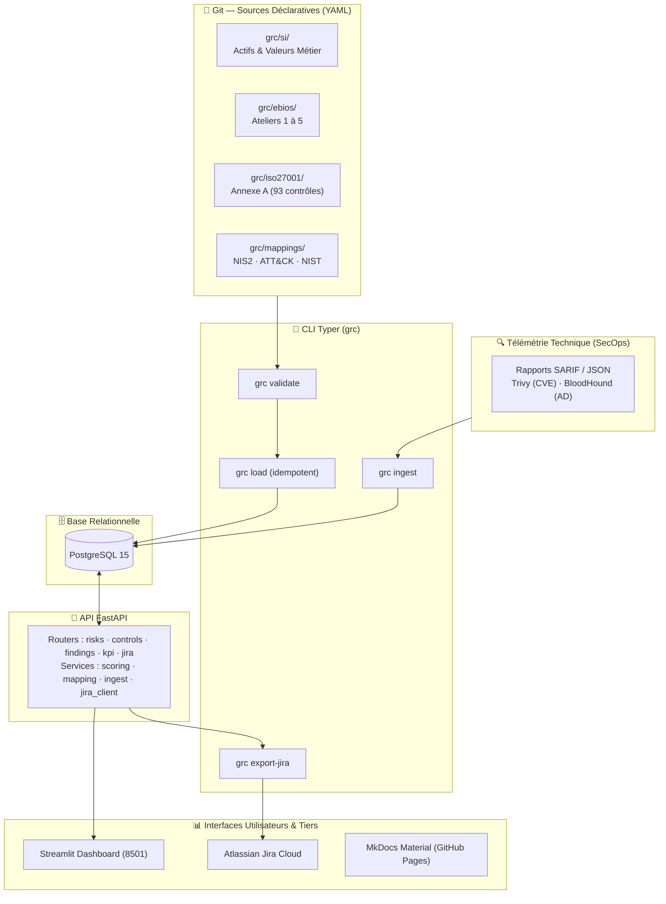

# Architecture Globale et Modèle de Données

Ce document décrit l'architecture technique, le modèle conceptuel de données et les principes de conception qui structurent la plateforme **GRC-as-Code**.

---

## 1. Objectifs et Livrables

Le projet s'articule autour de trois piliers interdépendants :

1. **Un dossier GRC formalisé sur le centre d'imagerie médicale** :
   - 5 ateliers EBIOS RM (du contexte aux traitements) ;
   - Déclaration d'Applicabilité ISO 27001:2022 (93 contrôles) ;
   - Plans de traitement des risques (logique ISO 27005) ;
   - Cartographie réglementaire croisée (Directive NIS 2, RGPD, référentiel HDS, NIST CSF 2.0, MITRE ATT&CK).
2. **Un outil de pilotage DevSecOps (FastAPI, PostgreSQL 15, Streamlit, CLI Typer)** :
   - Chargement idempotent et validation stricte du référentiel GRC ;
   - Ingestion des constats techniques (scans SARIF Trivy, audits Active Directory) ;
   - Calcul dynamique unifié des scores inhérents et résiduels ;
   - Synchronisation bidirectionnelle des traitements vers Jira Cloud (Atlassian REST API v3).
3. **Une vitrine open-source documentée** :
   - Documentation vivante publiée via MkDocs Material sur GitHub Pages ;
   - Pipeline d'intégration continue GitHub Actions.

---

## 2. Architecture Technique

### Principes de Conception
- **Le YAML est la source unique de vérité** : la base de données relationnelle est jetable et reconstructible à tout moment (`grc reset --yes && grc load`).
- **Aucun score arbitraire** : les niveaux de risque proviennent exclusivement du moteur de calcul centralisé (`app/services/scoring.py`), garantissant une stricte parité entre l'API, la CLI et le tableau de bord.
- **Traçabilité des dépendances** : les liaisons sont explicites et vérifiées en CI : `Risque → Contrôles → Mappings`, `Constat → Actif → Contrôle → Risque`.

---

## 3. Modèle de Données Relationnel

| Table | Description et Champs Clés |
| :--- | :--- |
| `business_value` | Valeurs métier du centre (id, nom, processus, événement redouté, gravité) |
| `asset` | Actifs de soutien (id, nom, type, criticité, valeurs métier associées) |
| `risk_source`, `objective` | Couples Sources de Risque / Objectifs Visés (ateliers 1 & 2) |
| `stakeholder` | Parties prenantes de l'écosystème et niveau de menace (atelier 3) |
| `strategic_scenario`, `operational_scenario` | Chemins d'attaque, techniques ATT&CK, vraisemblance (ateliers 3 & 4) |
| `risk` | Risques formalisés (gravité, vraisemblance, score inhérent/résiduel, propriétaire, statut) |
| `control` | Contrôles ISO 27001 (id, thème, applicable, justification, état, maturité 0–5, preuve) |
| `control_mapping` | Correspondances réglementaires (control_id, framework NIS2/ATT&CK/NIST, référence, source, confiance, justification) |
| `treatment` | Stratégie de traitement (option, échéance, responsable, jira_key) |
| `finding` | Constats de vulnérabilités (source SARIF, sévérité, actif lié, CVE, technique ATT&CK, date) |
| `finding_control`, `finding_risk` | Liaisons directes constat → contrôle défaillant et constat → risque aggravé |
| `regulation_scope` | Périmètre d'applicabilité NIS2 / RGPD / HDS / DGSSI |

---

## 4. Règles de Cohérence et Intégrité Vérifiées par la CI

1. **Exhaustivité des contrôles** : Chaque contrôle de l'Annexe A marqué `applicable: true` possède une justification contextualisée et un état de mise en œuvre ; chaque contrôle `applicable: false` possède un motif d'exclusion argumenté.
2. **Couverture des risques** : Tout risque opérationnel est rattaché à au moins un actif de soutien, possède un traitement formalisé et référence au moins un contrôle ISO 27001.
3. **Couverture réglementaire NIS 2** : Chacune des 10 mesures obligatoires de l'Article 21(2) de la directive NIS 2 est couverte par au moins un contrôle ISO 27001 applicable.
4. **Parité CLI / API** : Les calculs de vraisemblance ajustée, maturité moyenne et criticité résiduelle sont synchrones entre `grc validate`, `GET /risks` et les tableaux récapitulatifs.
